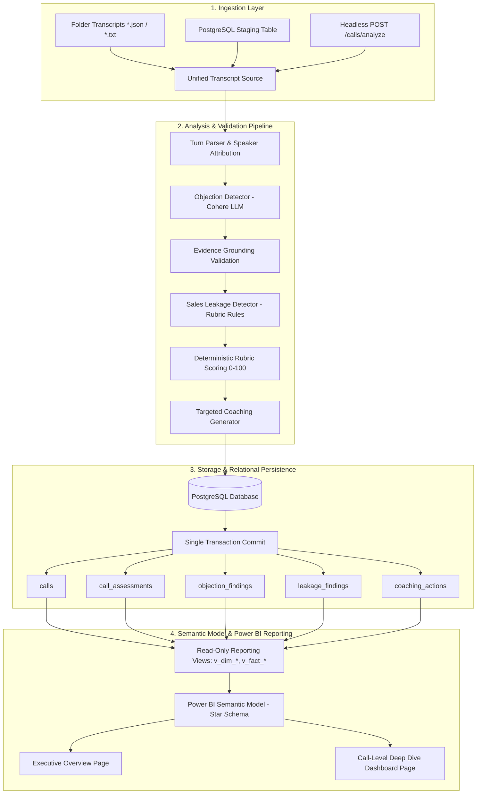

# Telesales Intelligence System (v2.0)
**Headless AI Pipeline for Jordanian Arabic Call Analysis, Quality Assurance & Power BI Reporting**

---

## 1. Executive Summary & Objective

The **Telesales Intelligence System** is a production-grade, headless backend and data engineering pipeline designed to audit, evaluate, and coach telesales operations in **Jordanian Arabic** (اللهجة الأردنية) with embedded **Arabic-English code-switching**.

Built with **Python**, pretrained **Cohere Large Language Models (Command R+)**, **PostgreSQL**, and **Microsoft Power BI**, the system operates with **zero human in the loop** upstream of Power BI.

For every ingested telesales call, the pipeline deterministically extracts:
1. **Customer Objections**: Categorized resistance (Price, Timing, Competitor, Trust, Need, Authority) with verbatim excerpts and agent handling effectiveness (`yes`, `partially`, `no`).
2. **Sales Leakage**: Missed commercial opportunities and execution failures (Missed Discovery, Unaddressed Objections, Missed Next Step) classified by severity and evidence class (`observed_failure`, `plausible_missed_opportunity`, `insufficient_evidence`).
3. **Actionable Coaching Actions**: Concrete, practical behavioral guidance with authentic Jordanian Arabic conversational script lines tied exclusively to verified audit findings.
4. **Call-Level Dashboard in Power BI**: A single, scalable Power BI report containing an interactive call-level drill-through page providing managers with a deep dive into each call.

---

## 2. End-to-End Pipeline Architecture



---

## 3. Project Directory Structure

```
telesales-intelligence/
├── app/
│   ├── main.py                     # FastAPI headless operations & health API
│   ├── config.py                   # Pydantic Settings configuration
│   ├── api/
│   │   └── calls.py                # Headless ingestion, retrieval, and supervisor review routes
│   ├── ingestion/
│   │   ├── sources.py              # Folder and database staging transcript sources
│   │   └── batch_runner.py         # Concurrency-bounded CLI batch execution runner
│   ├── schemas/
│   │   ├── transcript.py           # Pydantic input contract, turn parsers, and validation
│   │   └── analysis.py             # Strictly typed output models, taxonomies, and assessments
│   ├── services/
│   │   ├── llm_client.py           # Cohere ClientV2 client and Jordanian mock test engine
│   │   ├── objection_detector.py   # Colloquial Jordanian objection classification
│   │   ├── leakage_detector.py     # Sales leakage & opportunity detection
│   │   ├── coaching_generator.py   # Grounded, actionable behavioral recommendations
│   │   └── analysis_pipeline.py    # Pipeline coordinator & deterministic rubric scoring
│   ├── evaluation/
│   │   ├── metrics.py              # Precision, Recall, F1, and groundedness calculations
│   │   └── benchmark.py            # Repeatable benchmark suite with DB audit tracking
│   ├── retrieval/
│   │   └── knowledge_base.py       # Sales playbooks, rebuttals, and qualification rubrics
│   ├── db/
│   │   ├── models.py               # SQLAlchemy models (PostgreSQL 14+)
│   │   ├── session.py              # Engine configuration and connection pooling
│   │   ├── repository.py           # Atomic single-transaction persistence & lookups
│   │   └── migrations/             # Alembic versioned schema migrations
│   └── reporting/
│       ├── views.sql               # Read-only Power BI reporting views
│       └── powerbi_refresh.py      # Automated Power BI Service REST API refresh trigger
├── powerbi/
│   ├── README.md                   # Complete Power BI setup, Star Schema & RTL rendering guide
│   ├── measures.dax                # 35+ production DAX measures
│   ├── semantic_model.bim          # Tabular Model JSON definition (TOM)
│   └── report_layout.json          # Report layout and visual placement specifications
├── tests/                          # Complete automated test suite (24 unit/integration tests)
├── data/
│   ├── sample_transcripts/         # 5 realistic Jordanian Arabic telesales transcripts
│   └── benchmark_ground_truth.json # Ground-truth reference dataset for precision/recall
├── .env.example                    # Documented configuration template
├── requirements.txt                # Production dependency manifest
└── README.md                       # Comprehensive system documentation
```

---

## 4. Jordanian Arabic Dialect Engineering

Conversational Jordanian telesales interactions differ significantly from Modern Standard Arabic (MSA):
- **Colloquial Expressions**: Accurately recognizes *"غالي كتير"*, *"الراتب طار"*, *"بقدرش أدفع"*, *"مش فاضي هسة ملخوم بشغلي"*, *"فش داعي"*, *"بدي استشير مرتي/الوالد"*, *"النت عندكم بقطع"*.
- **Arabic-English Code-Switching**: Handles technical and sales loanwords embedded seamlessly within Arabic syntax (*"الـ package غالية"*, *"الـ budget tight هاد الـ quarter"*, *"شو بخصوص الـ SLA والـ upload speed"*).
- **Exact Verbatim Grounding**: Model excerpts are required to strictly match transcript substrings. Unverified or hallucinated findings are rejected by the pipeline prior to scoring.
- **Zero-Objection Support**: Calls with zero objections explicitly output 0 (not `NULL` or missing values), allowing Power BI cards and DAX measures to calculate accurate percentages.

---

## 5. Power BI Reporting & The "Call Dashboard"

The system adheres strictly to the requirement that **Power BI is the only human-facing output**:
- Power BI connects **only to database views** (`v_dim_calls`, `v_dim_categories`, `v_fact_call_assessments`, `v_fact_objections`, `v_fact_leakages`, `v_fact_coaching`).
- **Meaning of "A Dashboard for Each Call"**: One unified Power BI report contains a **dedicated Call-Level Page** that dynamically displays a single call selected by:
  1. **Drill-Through**: Right-click any call in the Executive Overview -> Drill-Through -> Call Dashboard.
  2. **Interactive Slicers**: Slicer dropdown on `v_dim_calls[call_id]`.
  3. **CRM Deep-Linking URL**:
     ```
     https://app.powerbi.com/groups/{workspace_id}/reports/{report_id}/ReportSection?filter=v_dim_calls/call_id eq 'CALL-JO-2026-001'
     ```
- **RTL Arabic Alignment**: Detailed documentation in [`powerbi/README.md`](powerbi/README.md) guides right-to-left formatting, typography (Segoe UI/Arial), and text wrapping.

---

## 6. Installation & Quickstart

### Prerequisites
- Python 3.11+ (CPython 3.12 recommended)
- PostgreSQL 14+ (or Podman/Docker container)

### Step 1: Clone & Create Virtual Environment
```bash
cd /home/Awadi/.gemini/antigravity-ide/scratch/telesales-intelligence
uv venv .venv --python 3.12
source .venv/bin/activate
uv pip install -r requirements.txt
```

### Step 2: Configure Environment
Copy `.env.example` to `.env` and set your database connection and Cohere API key:
```bash
cp .env.example .env
```
*(If `COHERE_API_KEY` is not provided, the system automatically runs in deterministic mock mode for local testing).*

### Step 3: Run Database Migrations & Create Views
```bash
alembic upgrade head
```

---

## 7. Operational Workflows

### 1. Run the Batch Ingestion Runner
Processes pending transcripts in parallel with thread-pool concurrency and isolated transactions:
```bash
python app/ingestion/batch_runner.py --source folder --folder ./data/sample_transcripts --concurrency 4
```

### 2. Start the Headless Operations API
Launches FastAPI with automated OpenAPI interactive documentation:
```bash
uvicorn app.main:app --host 0.0.0.0 --port 8000
```
- Health Check: `GET http://localhost:8000/health`
- Interactive API Docs: `http://localhost:8000/docs`
- Analyze Call Programmatically: `POST http://localhost:8000/calls/analyze`
- Fetch Call Dashboard Data: `GET http://localhost:8000/calls/{call_id}/dashboard-data`

### 3. Run Automated Tests
```bash
pytest -v
```

### 4. Run the Dialect Evaluation & Benchmark Suite
```bash
python app/evaluation/benchmark.py
```
Outputs Precision, Recall, F1, and Excerpt Groundedness, and persists the benchmark run to the database.

---

## 8. Supervisor Review Workflow (No Custom Frontend)

To record human supervisor decisions on findings without building a separate UI:
1. **Via Headless API**:
   ```bash
   curl -X POST http://localhost:8000/calls/CALL-JO-2026-001/review \
     -H "Content-Type: application/json" \
     -d '{
       "finding_type": "assessment",
       "finding_id": "CALL-JO-2026-001",
       "new_status": "accepted",
       "reviewer_notes": "Supervisor verified high quality price objection handling."
     }'
   ```
2. **Via Authorized SQL Update**:
   ```sql
   UPDATE call_assessments 
   SET review_status = 'accepted', reviewer_notes = 'Approved by Quality Lead' 
   WHERE call_id = 'CALL-JO-2026-001';
   ```
Power BI reflects supervisor review statuses immediately upon the next semantic model refresh.
